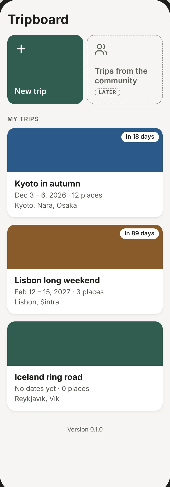
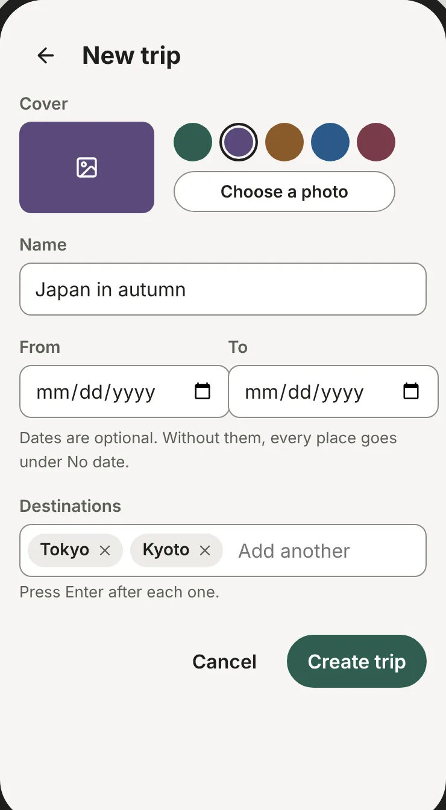
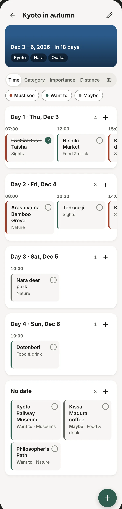
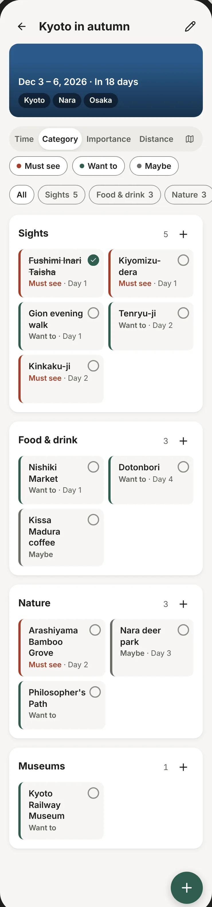
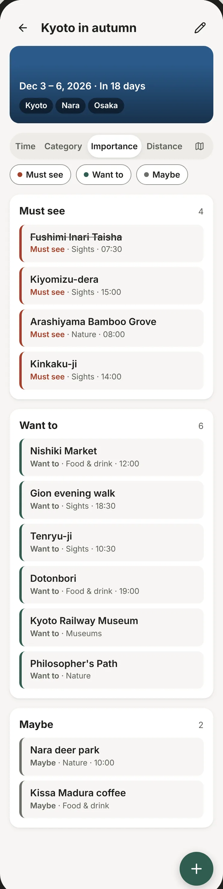
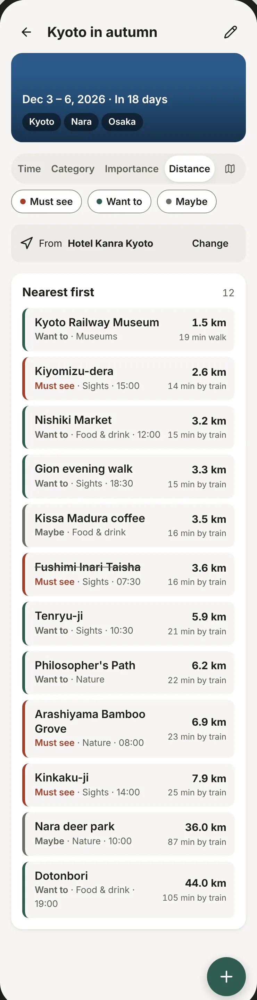
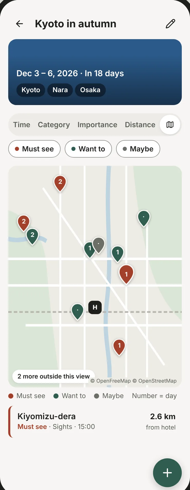
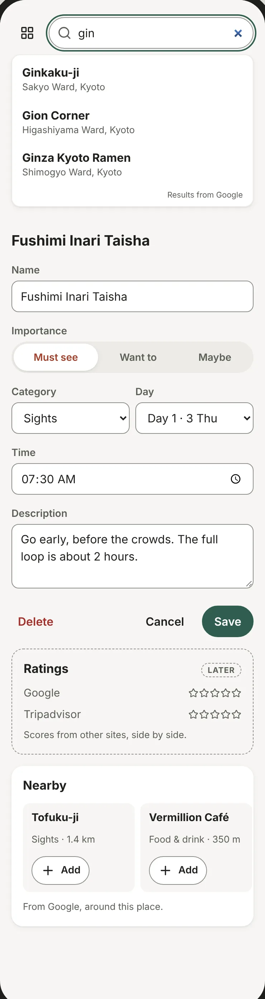

# Screens mockup

A clickable mockup of Daniel's v1 wireframe (2026-11-15), drawn with
Tripboard's own tokens and components. It is a design reference, not part of
the app, and its data is made up.

- `screens.html` is the source. It is one self-contained file: download it and
  open it in a browser to click through, or edit it like any other page.
- The `.webp` images are what each screen looks like, so it can be seen here on
  GitHub. Redo them after changing `screens.html`.
- Live copy: https://claude.ai/artifact/FJ4LJ5kZfaLRkBi14bC3BP

## Where it differs from the app on `feature/tripboard-start`

- The Time view shows each day's places left to right by clock time, as the
  wireframe does. The app groups a day into Morning, Afternoon and Evening.
- The Category view has category filter chips above the groups.
- "Later" marks community trips and ratings from other sites, which aren't in v1.

## Screens

| Home | New trip | Board: Time | Board: Category |
| --- | --- | --- | --- |
|  |  |  |  |

| Board: Importance | Board: Distance | Board: Map | Place |
| --- | --- | --- | --- |
|  |  |  |  |
